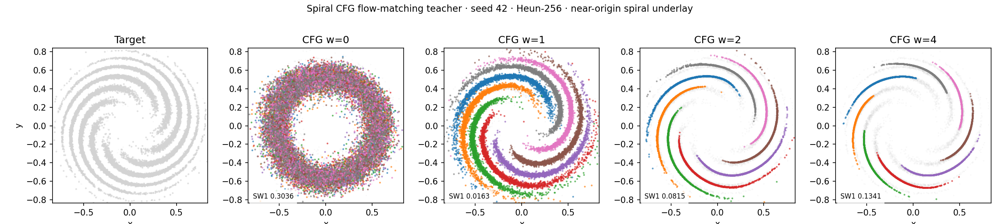
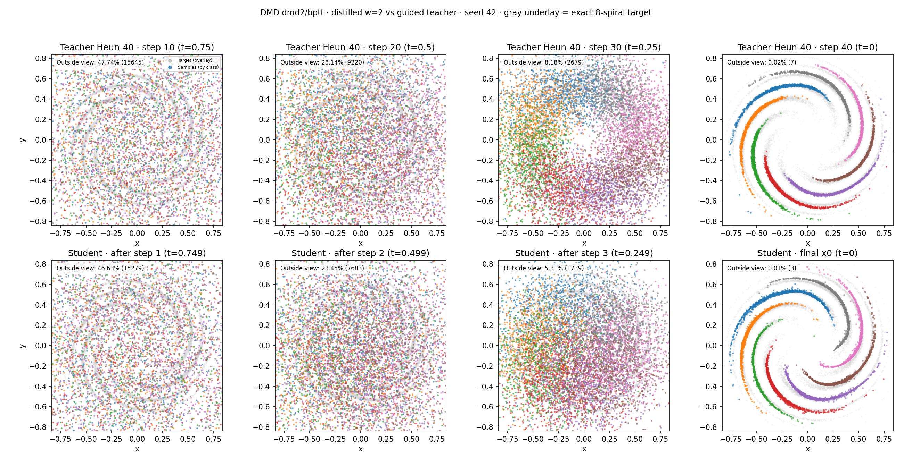
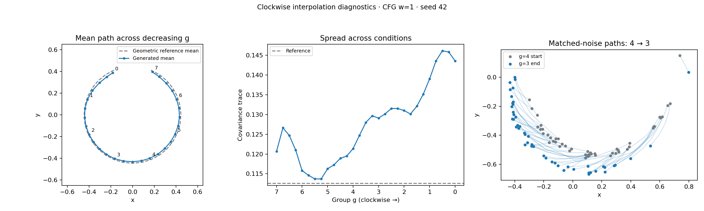

# Eight-spiral flow matching + DMD/DMD2 distillation (standalone)

A minimal, self-contained extract of the eight-arm "twisted Gaussians" toy
experiment: train a class-conditional CFG flow-matching teacher on the spiral,
distill it into a 4-step generator with the DMD family of losses, and probe the
teacher's frozen clockwise interpolation between class labels. Only the
flow-matching, DMD/DMD2, and class-interpolation code is included; the guidance,
pruning, adversarial, and architecture-ablation studies from the original
experiment are not.



## What is here

| file | purpose |
|---|---|
| `core.py` | Spiral geometry and sampling, conditional CFG U-MLP, linear flow path, Heun sampler, metrics, plotting helpers. |
| `train_flow.py` | Trains the conditional flow-matching teacher (10% class dropout) and renders a target/CFG sample grid. |
| `dmd.py` | DMD and DMD2 distillation, 8 arms = {DMD1, DMD2} × {backward simulation, BPTT} × guidance `w ∈ {2,4}`, plus evaluation and comparison figures. |
| `interpolate.py` | Frozen clockwise class-condition sweep `g=7→0` with shared noise and rotated geometric references; no retraining. |
| `run_all.sh` | Tests → teacher → all DMD arms → interpolation → prints figure paths. |
| `AGENTS.md` | Agent entrypoint: commands, smoke/full runs, artifact paths, invariants. |
| `CLAUDE.md` | Pointer to `AGENTS.md` for Claude-based agents. |
| `tests/test_pipeline.py` | 19 fast unit tests (data geometry, score identity, schedule, rollout grad masks, Heun snapshots, interpolation grid, checkpoint checks). |
| `requirements.txt` | Torch/NumPy/Matplotlib requirements. |
| `LICENSE` | MIT license. |
| `CITATION.cff` | Machine-readable citation metadata (GitHub “Cite this repository”). |
| `runs/` | Generated artifacts (checkpoints, histories, metrics, figures); not required for sharing. |
| `figures/` | Curated PNGs from the recorded run. |

## Setup

Python 3.10+, PyTorch, NumPy, and Matplotlib. From the repository root use its
virtualenv:

```bash
.venv/bin/python -c "import torch; print(torch.__version__, torch.cuda.is_available())"
```

CUDA is used when `--device cuda`; the code raises instead of silently falling
back to CPU. A 20k-step teacher takes under a minute on an RTX 5090; the eight
20k-step DMD arms take roughly 25 minutes in total.

## Reproduce

```bash
cd experiments/spiral_flow_dmd
python -m unittest discover -s tests -v
python train_flow.py all --device cuda --run-name teacher
python dmd.py all --device cuda --run-name dmd --teacher-run teacher
python interpolate.py --device cuda --teacher-run teacher --scales 1 2
```

Or in one command:

```bash
./run_all.sh cuda teacher dmd
```

Quick smoke (small batch/steps, a few seconds):

```bash
python train_flow.py all --device cuda --run-name smoke_teacher \
    --train-steps 50 --batch-size 256 --log-every 25 --eval-samples 128 --steps 32
python dmd.py all --device cuda --run-name smoke_dmd --teacher-run smoke_teacher \
    --gen-updates 50 --batch-size 256 --pairs 4096 --eval-samples 128 \
    --teacher-steps 8 --log-every 25 --probe-every 50 --scales 2
```

Every stage refuses to overwrite an existing checkpoint/output folder: pass a
fresh `--run-name`.

## Method

**Data.** Eight radial Gaussian arms (`radius 0.55`, `radial_std 0.10`,
`tangential_std 0.035`) rotated by `g·2π/8` and twisted by `6·r²`. The twist
has unit Jacobian, so the exact conditional density is available in closed
form. Class `c = g/7`; `c = -1` is the unconditional negative branch.

**Flow matching (teacher).** Linear path `x_t = (1-t)·x0 + t·ε` from data
(`t=0`) to noise (`t=1`), velocity target `ε - x0`, logit-normal times, MSE.
`FullCFGMLP` is a 4-input, width-128, 2-level U-shaped MLP whose two CFG
branches share all weights and always run the full middle. Training uses a
fixed-count 10% unconditional / 90% conditional split of each IID batch.
Sampling is Heun integration with ordinary CFG
`v = v_uncond + w·(v_cond − v_uncond)`.

**DMD/DMD2 (student).** A 4-step denoise/renoise rollout on DMD2's schedule
`{0.999, 0.749, 0.499, 0.249}`; the final clean estimate is the output. Linear
path identities:

```
x0_hat = x_t − t·v
eps_hat = x_t + (1−t)·v
score   s = −eps_hat / t
```

The distribution-matching gradient uses `d = s_fake − s_real` with the frozen
guided teacher as the real score and an online critic initialized from the
teacher. The default weight is `kl` (`w_t = 1`); the paper's L1 normalizer
(`--weight paper`) is available but was found unstable over 2 coordinates.
DMD2 uses TTUR (5 critic updates per generator update) and no regression; DMD1
adds the λ=0.25 regression anchor on pregenerated teacher ODE pairs.
`bsim` backpropagates through one rollout step, `bptt` through all four.

## Outputs

Teacher (`runs/teacher/`):
- `checkpoint.pt`, `config.json`, `history.json`
- `training_loss.png`
- `teacher_samples.png` — exact target vs Heun-256 samples at `w = 0,1,2,4`
- `teacher_metrics.json` — per-scale SW1/HDR/assignment metrics

DMD (`runs/dmd/`):
- one folder per arm, e.g. `dmd2_bptt_w2/`: `generator.pt`, `fake.pt`,
  teacher copy, `config.json`, `history.json`, `training_curves.png`
- `evaluation_s40_n4096_seed1234/<arm>/trajectory_progression.png` — teacher
  Heun-40 snapshots at steps 10/20/30/40 vs student steps 1–4
- `comparison_w2.png`, `comparison_w4.png` — all arms vs both teachers and the
  exact target, with a class-4 close-up
- `evaluation_*/summary.json` — per-arm SW1/HDR/center error table

Interpolation (`runs/teacher/interpolation_*/`):
- `metrics.json` — per-scale rotation direction, step angles, unseen/trained
  metrics, matched-noise displacements
- `clockwise_all_intervals_w{1,2}.png` — full 7→0 grid, 5 panels per interval
- `clockwise_4_to_3_w*.png` — the closest unseen interval in detail
- `clockwise_paths_w*.png` — mean path, covariance trace, matched-noise paths

Curated copies of the key figures live in `figures/`.

<!-- RESULTS -->

## Recorded results (seed 42)

Teacher, measured against the exact per-class target with its own 4096-sample
evaluation draw (`runs/teacher/teacher_metrics.json`):

| CFG scale | SW1 | HDR50 | requested-class assignment |
|---|---|---|---|
| w=0 (unconditional) | 0.30358 | 1.5% | 12.4% |
| w=1 | **0.01626** | 39.1% | 99.2% |
| w=2 | 0.08147 | 74.7% | 99.8% |
| w=4 | 0.13411 | 80.0% | 99.9% |

DMD/DMD2 students after 20k generator updates (`evaluation_*/summary.json`):

| arm | student SW1 | teacher-256 SW1 | HDR50 | center err |
|---|---|---|---|---|
| dmd1_bsim_w2 | 0.10103 | 0.08209 | 19.6% | 2.21 |
| dmd1_bptt_w2 | 0.10047 | 0.08209 | 17.6% | 3.19 |
| dmd2_bsim_w2 | **0.06976** | 0.08209 | 19.6% | 2.12 |
| dmd2_bptt_w2 | 0.08070 | 0.08209 | **48.0%** | **0.89** |
| dmd1_bsim_w4 | 0.13512 | 0.13554 | 30.5% | 1.81 |
| dmd1_bptt_w4 | 0.12394 | 0.13554 | 40.3% | 1.35 |
| dmd2_bsim_w4 | **0.11892** | 0.13554 | 24.6% | 1.92 |
| dmd2_bptt_w4 | 0.12139 | 0.13554 | 38.5% | 1.35 |

Reading: DMD2 beats its own guided teacher on SW1-vs-target; DMD1's regression
anchor fights the distribution-matching push; BPTT preserves distribution shape
(HDR50/center error) much better than backward simulation. The students land
between the conditional and guided distributions rather than copying the
teacher's CFG bias. Probe SW1 was still improving at 20k, so the arms are
undertrained rather than equilibrated.


*DMD final outputs at `w=2` on the spiral. Top row: 8-class mixture; bottom row:
class-4 close-up. Gray is the exact target. Same axes and initial noise.*



*`dmd2_bptt_w2` progression: teacher Heun-40 at steps 10/20/30/40 (top) versus
the student's four denoise/renoise steps (bottom).*

## Frozen clockwise class interpolation (generalization)

`interpolate.py` freezes the seed-42 teacher and sweeps 29 fractional conditions
`g = 7, 6.75, …, 0` (`c = g/7`) with **identical initial noise** in every panel.
Decreasing `g` is clockwise. Only integer groups were trained, so interior
conditions are unseen; the gray reference is the group-0 target rotated by
`g·45°`, a hypothetical geometric continuation rather than supervision.

| CFG | total mean rotation | clockwise steps | unseen SW1 | unseen HDR50 | min mean radius | adjacent RMS move |
|---|---|---|---|---|---|---|
| w=1 | **−310.3°** | **28/28** | **0.01769** | 39.3% | 0.423 | 0.121–0.169 |
| w=2 | −311.7° | **28/28** | 0.07567 | 75.9% | 0.513 | 0.112–0.151 |

Geometric expectation is −315° for the full sweep. At `w=1` the unseen
conditions score essentially the same as the trained endpoints (unseen SW1
0.01769 vs trained 0.01816), so the conditioning behaves as a smooth,
near-rotation-equivariant scalar rather than eight isolated classes. `w=2`
rotates just as smoothly but with the expected CFG expansion (larger radius and
HDR mass). There is no periodic `0→7` wrap in the scalar encoding, so that
interval is not evaluated.



*Generated mean path versus the geometric reference, spread across conditions,
and matched-noise paths for the unseen `g=4→3` interval. Same initial noise in
every condition.*


*The `g=4→3` interval in detail: endpoints are trained, the three interior
conditions are unseen. Gray is the rotated geometric reference.*

[Full 7→0 grid at w=2 (29 conditions)](figures/interpolation_all_w2.png)

Key figures:

- `figures/interpolation_all_w2.png` — every fractional condition, 7→0
- `figures/interpolation_4to3_w1.png` — unseen g=4→3 interval in detail
- `figures/interpolation_paths_w1.png`, `..._w2.png` — mean path, spread, matched-noise paths
- `figures/teacher_samples.png` — target vs teacher at `w=0,1,2,4`
- `figures/comparison_w2.png`, `figures/comparison_w4.png` — all arms vs teachers
- `figures/trajectory_dmd2_bptt_w2.png` — teacher vs student 4-step progression
- `figures/training_curves_dmd2_bptt_w2.png`

These numbers match the original experiment's recorded table and the recorded
clockwise behavior, which validates the extraction.


## Notes

- Single training seed (42). No EMA and no GAN loss (DMD2's other two upgrades).
- `w>1` means the distillation target is the *guided* (biased) distribution,
  not the exact data distribution; teacher rows are reported for comparison.
- Student renoise uses fresh noise per step, so its 4-step output is stochastic
  while the teacher ODE is deterministic (`renoise_redraw_rmse > 0`).
- The regression pairs for DMD1 use Heun-256; the trajectory figure shows the
  cheaper Heun-40 teacher row.
- Interpolation conditions are fractional (`c` between trained labels). The gray
  rotated target is a geometric reference only; smooth clockwise motion is
  evidence of continuity/direction, not exact rotational equivariance, and the
  scalar encoding has no periodic `0→7` interval.

## Citation

If you use this code or the experiments, please cite the repository. GitHub also
shows a **Cite this repository** button from [`CITATION.cff`](CITATION.cff).

```bibtex
@misc{lodestone2026spiraldmd,
  author       = {Lodestone},
  title        = {Spiral Flow Matching and {DMD}/{DMD2} Distillation},
  year         = {2026},
  howpublished = {\url{https://github.com/lodestone-rock/spiral-flow-dmd}},
  note         = {GitHub repository}
}
```

Plain text: Lodestone (2026). *Spiral Flow Matching and DMD/DMD2 Distillation*.
GitHub. https://github.com/lodestone-rock/spiral-flow-dmd

## License

MIT © 2026 Lodestone. See [LICENSE](LICENSE).

## Provenance

Extracted from `experiments/toy_2d_diffusion` (`toy_2d_diffusion.py`,
`depth_drop_guidance.py`, `dmd_distill.py`, `interpolate_guidance.py`, and their
metrics helpers), keeping the same model, data, schedules, interpolation order,
and evaluation definitions while removing unrelated experiments and dependencies.
