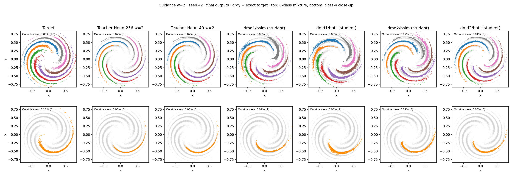
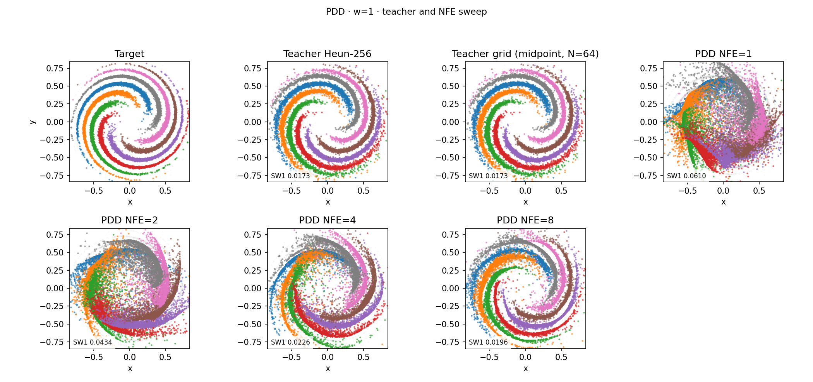
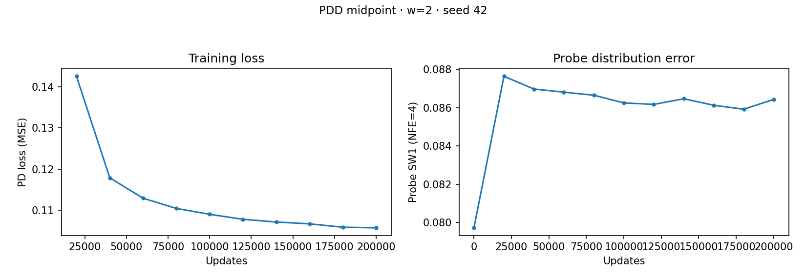
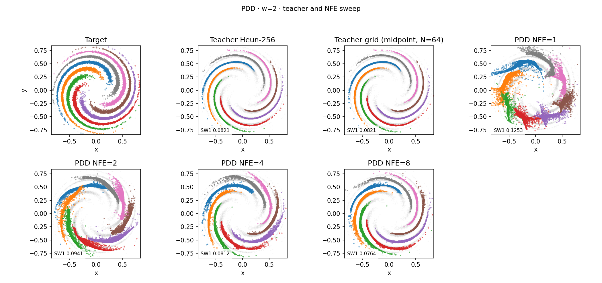
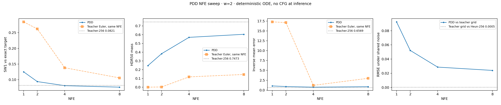
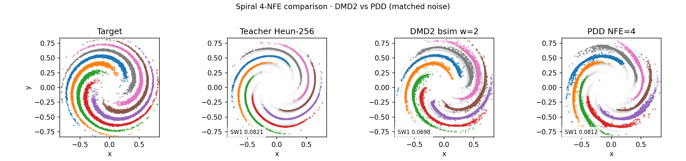
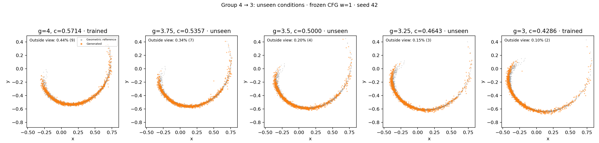
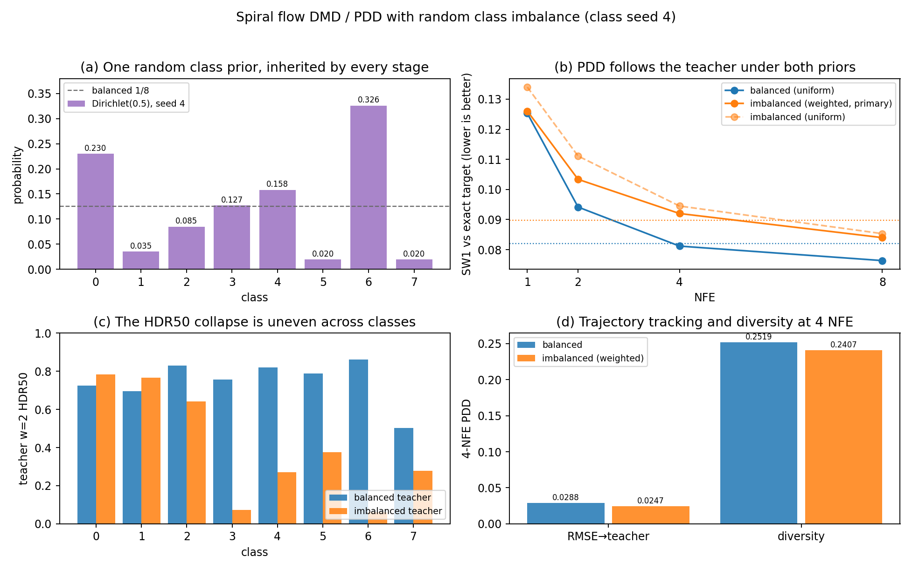
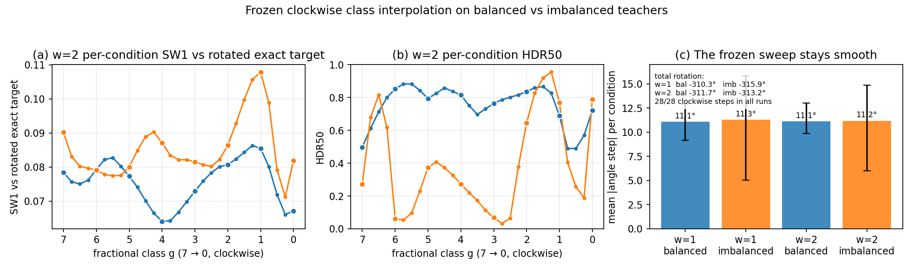

# Eight-spiral flow matching + DMD/DMD2 distillation (standalone)

A minimal, self-contained extract of the eight-arm "twisted Gaussians" toy
experiment: train a class-conditional CFG flow-matching teacher on the spiral,
distill it into a 4-step generator with the DMD family of losses, and probe the
teacher's frozen clockwise interpolation between class labels. Only the
flow-matching, DMD/DMD2, and class-interpolation code is included; the guidance,
pruning, adversarial, and architecture-ablation studies from the original
experiment are not.


## What is here

| file | purpose |
|---|---|
| `core.py` | Spiral geometry and sampling, random class priors, conditional CFG U-MLP, linear flow path, Heun sampler, metrics (uniform and class-weighted), plotting helpers. |
| `train_flow.py` | Trains the conditional flow-matching teacher (10% class dropout) and renders a target/CFG sample grid. `--class-alpha/--class-seed` draw a dataset-level class prior. |
| `dmd.py` | DMD and DMD2 distillation, 8 arms = {DMD1, DMD2} × {backward simulation, BPTT} × guidance `w ∈ {2,4}`, plus evaluation and comparison figures. |
| `pdd.py` | Parallel decoding distillation: widen the teacher's final linear to `N=64` interval heads, train on-policy against midpoint teacher targets, fuse heads per block at inference; one checkpoint serves NFE 1/2/4/8. |
| `interpolate.py` | Frozen clockwise class-condition sweep `g=7→0` with shared noise and rotated geometric references; no retraining. |
| `run_all.sh` | Tests → teacher → all DMD arms → PDD → interpolation → prints figure paths. `CLASS_ALPHA`/`CLASS_SEED` select the class prior. |
| `AGENTS.md` | Agent entrypoint: commands, smoke/full runs, artifact paths, invariants. |
| `CLAUDE.md` | Pointer to `AGENTS.md` for Claude-based agents. |
| `tests/test_pipeline.py` | 24 fast pipeline unit tests (geometry, score identity, schedule, rollout grad masks, Heun snapshots, interpolation grid, checkpoint checks, class priors and weighted averages). |
| `tests/test_pdd.py` | 17 fast PDD unit tests (grid/shift, head init, prefix advance, fused-vs-materialized heads, Euler/midpoint targets, closed-form constant teacher, data-free carry). |
| `requirements.txt` | Torch/NumPy/Matplotlib requirements. |
| `LICENSE` | MIT license. |
| `CITATION.cff` | Machine-readable citation metadata (GitHub “Cite this repository”). |
| `runs/` | Generated artifacts (checkpoints, histories, metrics, figures); not required for sharing. |
| `figures/` | Curated PNGs from the recorded run. |

## Setup

Python 3.10+, PyTorch, NumPy, and Matplotlib. From the repository root use its
virtualenv:

```bash
.venv/bin/python -c "import torch; print(torch.__version__, torch.cuda.is_available())"
```

CUDA is used when `--device cuda`; the code raises instead of silently falling
back to CPU. A 20k-step teacher takes under a minute on an RTX 5090; the eight
20k-step DMD arms take roughly 25 minutes in total.

## Reproduce

```bash
cd experiments/spiral_flow_dmd
python -m unittest discover -s tests -v
python train_flow.py all --device cuda --run-name teacher
python dmd.py all --device cuda --run-name dmd --teacher-run teacher
python pdd.py all --device cuda --run-name pdd --teacher-run teacher --scales 2 \
    --rk midpoint --steps 64 --block-min 8 --block-max 64 --heads 1 \
    --updates 50000 --batch-size 2048 --lr 0.001
python interpolate.py --device cuda --teacher-run teacher --scales 1 2
```

Or in one command:

```bash
./run_all.sh cuda teacher dmd pdd
```

For the random class-imbalanced rerun:

```bash
CLASS_ALPHA=0.5 CLASS_SEED=4 ./run_all.sh cuda teacher_imb dmd_imb pdd_imb
```

`--class-alpha 0` is the balanced control; with `alpha > 0` the teacher stores
one `Dirichlet(alpha)` class prior and DMD/PDD inherit it. See
[Random class imbalance](#random-class-imbalance-representative-rerun).

Quick smoke (small batch/steps, a few seconds):

```bash
python train_flow.py all --device cuda --run-name smoke_teacher \
    --train-steps 50 --batch-size 256 --log-every 25 --eval-samples 128 --steps 32
python dmd.py all --device cuda --run-name smoke_dmd --teacher-run smoke_teacher \
    --gen-updates 50 --batch-size 256 --pairs 4096 --eval-samples 128 \
    --teacher-steps 8 --log-every 25 --probe-every 50 --scales 2
python pdd.py all --device cuda --run-name smoke_pdd --teacher-run smoke_teacher \
    --updates 50 --batch-size 256 --eval-samples 128 --teacher-steps 8 \
    --log-every 25 --probe-every 50 --probe-samples 64 --scales 2
```

Every stage refuses to overwrite an existing checkpoint/output folder: pass a
fresh `--run-name`.

## Method

**Data.** Eight radial Gaussian arms (`radius 0.55`, `radial_std 0.10`,
`tangential_std 0.035`) rotated by `g·2π/8` and twisted by `6·r²`. The twist
has unit Jacobian, so the exact conditional density is available in closed
form. Class `c = g/7`; `c = -1` is the unconditional negative branch.

**Class prior.** The default dataset is balanced (`p_g = 1/8`). Passing
`--class-alpha > 0` draws one prior from `Dirichlet(alpha)` with
`--class-seed`, floors it at `--class-floor` before normalization, stores it in
the teacher config, and samples every stage (teacher, DMD pairs/rollouts, PDD
starts, evaluation calibration) from it. Per-class metrics are always written
uniformly and under the prior (`weighted_average`); imbalanced summaries use the
weighted value.

**Flow matching (teacher).** Linear path `x_t = (1-t)·x0 + t·ε` from data
(`t=0`) to noise (`t=1`), velocity target `ε - x0`, logit-normal times, MSE.
`FullCFGMLP` is a 4-input, width-128, 2-level U-shaped MLP whose two CFG
branches share all weights and always run the full middle. Training uses a
fixed-count 10% unconditional / 90% conditional split of each IID batch.
Sampling is Heun integration with ordinary CFG
`v = v_uncond + w·(v_cond − v_uncond)`.

**DMD/DMD2 (student).** A 4-step denoise/renoise rollout on DMD2's schedule
`{0.999, 0.749, 0.499, 0.249}`; the final clean estimate is the output. Linear
path identities:

```
x0_hat = x_t − t·v
eps_hat = x_t + (1−t)·v
score   s = −eps_hat / t
```

The distribution-matching gradient uses `d = s_fake − s_real` with the frozen
guided teacher as the real score and an online critic initialized from the
teacher. The default weight is `kl` (`w_t = 1`); the paper's L1 normalizer
(`--weight paper`) is available but was found unstable over 2 coordinates.
DMD2 uses TTUR (5 critic updates per generator update) and no regression; DMD1
adds the λ=0.25 regression anchor on pregenerated teacher ODE pairs.
`bsim` backpropagates through one rollout step, `bptt` through all four.

**PDD (student).** The paper's convention is `t=0` noise → `t=1` data, the
opposite of this repo, so `pdd.py` works in the bridge `s = 1 − t` (noise →
data): the student predicts `u_s = dx/ds = −v_t`, its heads initialize from
`−teacher.output`, and integration steps are positive. The teacher's final
linear is widened to `N=64` heads, one per interval of a uniform 64-node grid;
every head reads the same backbone feature at the block start. At each update a
block start is drawn from the eight student-grid nodes, `K=1` interval head is
drawn from `[start, start+64)`, the student's detached parallel heads roll the
state forward to that head, and the head is regressed onto the guided teacher's
midpoint Runge–Kutta estimate of the interval mean velocity
`ū ≈ (1/Δs)∫u_s ds`. There is no critic, GAN, JVP, or BPTT.

At inference a block's heads are fused into one effective linear,

```text
x_{n+L} = x_n + (s_{n+L} − s_n) · W_fused H(x_n),
W_fused = Σ_k (Δ_k / (s_{n+L} − s_n)) W_k,
```

so a 4-NFE sample is four backbone passes, each with one fused linear readout, and
one checkpoint serves NFE 1/2/4/8. `--data-free` switches from exact data starts
to a carried student trajectory; `--shift` warps the grid toward the noise side
(paper Eq. 16; `1` is uniform). The default toy recipe is `N=64`, `L_min=8`,
`L_max=64`, midpoint, `K=1`, data-dependent, 50k updates at `lr=1e-3` (the
main table uses 200k; 4-NFE SW1/RMSE are flat by 50k).

## Outputs

Teacher (`runs/teacher/`):
- `checkpoint.pt`, `config.json`, `history.json`
- `training_loss.png`
- `teacher_samples.png` — exact target vs Heun-256 samples at `w = 0,1,2,4`
- `teacher_metrics.json` — per-scale SW1/HDR/assignment metrics

DMD (`runs/dmd/`):
- one folder per arm, e.g. `dmd2_bptt_w2/`: `generator.pt`, `fake.pt`,
  teacher copy, `config.json`, `history.json`, `training_curves.png`
- `evaluation_s40_n4096_seed1234/<arm>/trajectory_progression.png` — teacher
  Heun-40 snapshots at steps 10/20/30/40 vs student steps 1–4
- `comparison_w2.png`, `comparison_w4.png` — all arms vs both teachers and the
  exact target, with a class-4 close-up
- `evaluation_*/summary.json` — per-arm SW1/HDR/center error table

PDD (`runs/pdd/`):
- one folder per arm, e.g. `pdd_midpoint_w2/`: `generator.pt`, `config.json`,
  `history.json`, `training_curves.png`
- `evaluation_s256_n4096_seed1234/summary.json` — SW1/HDR50, diversity, and
  RMSE to the teacher grid and to Heun-256 under shared noise, with Euler-NFE
  and Heun-NFE teacher baselines
- `evaluation_*/pdd_midpoint_w2_samples.npz` — matched-noise student arrays for
  every NFE plus `teacher_grid` and `teacher_256`
- `pdd_samples_w2.png` — target, both teachers, and the NFE sweep
- `pdd_nfe_sweep_w2.png` — distribution and trajectory-agreement panels
- `pdd_vs_dmd_w2.png` — matched-noise DMD2 vs PDD at 4 NFE
- curated numbers: `results/pdd_summary.json`

Class-imbalanced rerun (`runs/teacher_imb/`, `runs/dmd_imb/`, `runs/pdd_imb/`):
- same artifacts as above, with the class prior recorded in every `config.json`
- `evaluation_*/summary.json` and `metrics.json` carry both `average` and
  `weighted_average`; the weighted value is the primary one
- curated numbers: `results/imbalanced_summary.json`

Interpolation (`runs/teacher/interpolation_*/`):
- `metrics.json` — per-scale rotation direction, step angles, unseen/trained
  metrics, matched-noise displacements
- `clockwise_all_intervals_w{1,2}.png` — full 7→0 grid, 5 panels per interval
- `clockwise_4_to_3_w*.png` — the closest unseen interval in detail
- `clockwise_paths_w*.png` — mean path, covariance trace, matched-noise paths

Curated copies of the key figures live in `figures/`.

<!-- RESULTS -->

## Balanced recorded results (seed 42)

Teacher, measured against the exact per-class target with its own 4096-sample
evaluation draw (`runs/teacher/teacher_metrics.json`):

| CFG scale | SW1 | HDR50 | requested-class assignment |
|---|---|---|---|
| w=0 (unconditional) | 0.30358 | 1.5% | 12.4% |
| w=1 | **0.01626** | 39.1% | 99.2% |
| w=2 | 0.08147 | 74.7% | 99.8% |
| w=4 | 0.13411 | 80.0% | 99.9% |

DMD/DMD2 students after 20k generator updates (`evaluation_*/summary.json`):

| arm | student SW1 | teacher-256 SW1 | HDR50 | center err |
|---|---|---|---|---|
| dmd1_bsim_w2 | 0.10103 | 0.08209 | 19.6% | 2.21 |
| dmd1_bptt_w2 | 0.10047 | 0.08209 | 17.6% | 3.19 |
| dmd2_bsim_w2 | **0.06976** | 0.08209 | 19.6% | 2.12 |
| dmd2_bptt_w2 | 0.08070 | 0.08209 | **48.0%** | **0.89** |
| dmd1_bsim_w4 | 0.13512 | 0.13554 | 30.5% | 1.81 |
| dmd1_bptt_w4 | 0.12394 | 0.13554 | 40.3% | 1.35 |
| dmd2_bsim_w4 | **0.11892** | 0.13554 | 24.6% | 1.92 |
| dmd2_bptt_w4 | 0.12139 | 0.13554 | 38.5% | 1.35 |

Reading: DMD2 beats its own guided teacher on SW1-vs-target; DMD1's regression
anchor fights the distribution-matching push; BPTT preserves distribution shape
(HDR50/center error) much better than backward simulation. The students land
between the conditional and guided distributions rather than copying the
teacher's CFG bias. Probe SW1 was still improving at 20k, so the arms are
undertrained rather than equilibrated.



*DMD final outputs at `w=2` on the spiral. Top row: 8-class mixture; bottom row:
class-4 close-up. Gray is the exact target. Same axes and initial noise.*


*`dmd2_bptt_w2` progression: teacher Heun-40 at steps 10/20/30/40 (top) versus
the student's four denoise/renoise steps (bottom).*

## Parallel decoding distillation (PDD)

The PDD arm reuses the frozen `w=2` teacher and the toy recipe in `pdd.py`
(`N=64` midpoint interval heads, `K=1`, `L_min=8`, `L_max=64`,
data-dependent, seed 42). It is a **trajectory** distillator: it learns the
guided teacher's field, not the exact target, so its primary check is agreement
with the teacher rather than SW1 alone. Metrics below use 4096 matched-noise
samples per class; `RMSE→teacher` is the per-coordinate disagreement with the
teacher grid under the same noise.

| method | NFE | SW1 vs target ↓ | HDR50 | diversity | RMSE→teacher ↓ |
|---|---|---|---|---|---|
| Teacher Heun-256, `w=2` | 256 | 0.0821 | 74.7% | 0.248 | — |
| Teacher Euler-8, `w=2` | 8 | 0.1059 | 14.6% | 0.186 | — |
| Teacher Euler-4, `w=2` | 4 | 0.1383 | 11.8% | 0.143 | — |
| DMD2 bsim, `w=2` | 4 | **0.0698** | 19.6% | 0.307 | 0.256 |
| DMD2 bptt, `w=2` | 4 | 0.0807 | 48.0% | 0.277 | 0.244 |
| PDD midpoint, `w=2` (200k) | 1 | 0.1253 | 24.7% | 0.169 | 0.092 |
| | 2 | 0.0942 | 38.3% | 0.222 | 0.052 |
| | 4 | 0.0812 | 57.0% | 0.252 | **0.0288** |
| | 8 | 0.0764 | 60.5% | 0.267 | **0.0241** |

Reading: PDD at 4 NFE lands on the teacher's own SW1 (0.0812 vs 0.0821) with
four backbone calls instead of Heun-256's 512. DMD2's lower SW1 is not the same
object: it has moved the distribution (RMSE 0.256 from the teacher), while PDD
tracks it (0.0288, about 9× closer) and matches its diversity (0.252 vs 0.248).
DMD2-bsim is overdispersed (0.307); DMD2-bptt is closer but still 8× farther
from the teacher than PDD. PDD also beats the same-NFE Euler teacher by a wide
margin (0.081 vs 0.138 at 4 NFE), which is the actual few-step-solver baseline.
At 1 NFE it is 0.125 vs 0.285; at 8 NFE 0.076 vs 0.082 for Heun-256.

The main residual is HDR50: 57% at 4 NFE versus 74.7% for the teacher, so the
parallel heads capture the trajectory but still under-fill the arm centers.
The 50k and 200k checkpoints are within noise on SW1/RMSE, so this toy recipe
converges by roughly 50k updates. `w=4` is harder: the high-CFG field is
steeper, and even 200k leaves the arm underfit (SW1 0.142 vs teacher grid
0.136; RMSE 0.052; DMD2-bsim-w4 0.119). More capacity or the paper's lower
guidance is the natural next step.

Ablations (50k updates, `w=2` unless noted; 4-NFE metrics):

| variant | 4-NFE SW1 ↓ | RMSE→teacher ↓ | diversity | note |
|---|---|---|---|---|
| uniform midpoint, `N=64`, `K=1` (main) | **0.0812** | **0.0288** | 0.252 | 200k; 50k is 0.0816 / 0.0287 |
| `lr=1e-4` | 0.0879 | 0.0322 | 0.236 | slower; the 1e-3 toy lr is better |
| Euler, `N=128`, `K=2` | 0.0839 | 0.0286 | 0.243 | same accuracy, 2× head params and 2 teacher calls |
| shifted grid `s=2` | 0.0868 | 0.0402 | 0.240 | worse at 4 NFE; 1 NFE slightly better (0.120 vs 0.125) |
| data-free carry (10k) | 0.0884 | 0.0300 | 0.236 | Algorithm 3 works; close to the 50k data-dependent arm |
| `w=1` clean-field control | **0.0226** | 0.0578 | 0.379 | teacher grid 0.0173; not comparable to the `w=2` DMD rows |

The Euler `N=128` recipe is a wash: it matches the midpoint `N=64` trajectory
error with twice the head overhead. The paper's time shift, at least at `s=2`,
does not help the 4-NFE end on this toy; it trades a little 1-NFE SW1 for a
larger trajectory error. The data-free carry reaches 0.0884 / 0.0300 in only
10k updates, so Algorithm 3 is viable here even though the spiral has exact
data. The `w=1` control shows the method itself is sound on a clean field
(4-NFE SW1 0.023 vs teacher 0.017), which isolates the `w=4` underfit to the
steeper guided field rather than a coordinate bug.



*The clean-field control. NFE 4 is close to the teacher; NFE 1 shows the
expected one-block failure.*



*Training loss and 4-NFE probe SW1 at `w=2`. The probe is flat after about
50k; the loss keeps drifting down slowly.*



*Target, Heun-256, the 64-node midpoint teacher grid, and one PDD checkpoint at
NFE 1/2/4/8. Same initial noise; gray is the exact target.*



*SW1, HDR50, center error, and RMSE to the teacher grid versus NFE, with the
same-NFE Euler teacher and Heun-256 reference.*



*Matched-noise 4-NFE comparison. DMD2-bsim has the best SW1 but visibly departs
from the teacher; PDD tracks the teacher's arms.*

## Frozen clockwise class interpolation (generalization)

`interpolate.py` freezes the seed-42 teacher and sweeps 29 fractional conditions
`g = 7, 6.75, …, 0` (`c = g/7`) with **identical initial noise** in every panel.
Decreasing `g` is clockwise. Only integer groups were trained, so interior
conditions are unseen; the gray reference is the group-0 target rotated by
`g·45°`, a hypothetical geometric continuation rather than supervision.

| CFG | total mean rotation | clockwise steps | unseen SW1 | unseen HDR50 | min mean radius | adjacent RMS move |
|---|---|---|---|---|---|---|
| w=1 | **−310.3°** | **28/28** | **0.01769** | 39.3% | 0.423 | 0.121–0.169 |
| w=2 | −311.7° | **28/28** | 0.07567 | 75.9% | 0.513 | 0.112–0.151 |

Geometric expectation is −315° for the full sweep. At `w=1` the unseen
conditions score essentially the same as the trained endpoints (unseen SW1
0.01769 vs trained 0.01816), so the conditioning behaves as a smooth,
near-rotation-equivariant scalar rather than eight isolated classes. `w=2`
rotates just as smoothly but with the expected CFG expansion (larger radius and
HDR mass). There is no periodic `0→7` wrap in the scalar encoding, so that
interval is not evaluated.


*Generated mean path versus the geometric reference, spread across conditions,
and matched-noise paths for the unseen `g=4→3` interval. Same initial noise in
every condition.*



*The `g=4→3` interval in detail: endpoints are trained, the three interior
conditions are unseen. Gray is the rotated geometric reference.*

[Full 7→0 grid at w=2 (29 conditions)](figures/interpolation_all_w2.png)

Key figures:

- `figures/interpolation_all_w2.png` — every fractional condition, 7→0
- `figures/interpolation_4to3_w1.png` — unseen g=4→3 interval in detail
- `figures/interpolation_paths_w1.png`, `..._w2.png` — mean path, spread, matched-noise paths
- `figures/teacher_samples.png` — target vs teacher at `w=0,1,2,4`
- `figures/comparison_w2.png`, `figures/comparison_w4.png` — all arms vs teachers
- `figures/trajectory_dmd2_bptt_w2.png` — teacher vs student 4-step progression
- `figures/training_curves_dmd2_bptt_w2.png`
- `figures/pdd_samples_w2.png` — PDD NFE 1/2/4/8 vs both teachers
- `figures/pdd_nfe_sweep_w2.png` — distribution and teacher-RMSE diagnostics
- `figures/pdd_vs_dmd_w2.png` — matched-noise DMD2 vs PDD at 4 NFE
- `figures/pdd_samples_w1.png` — clean-field `w=1` control
- `figures/pdd_training_curves_w2.png` — PDD loss and probe SW1
- `figures/imbalanced_vs_balanced.png` — random class prior and the rerun comparison
- `figures/class_prior_imb.png` — prior and teacher SW1/HDR50 under imbalance
- `figures/teacher_imb_samples.png` — imbalanced teacher sample grid
- `figures/interpolation_imb_vs_balanced.png` — balanced vs imbalanced class sweep
- `figures/interpolation_all_w2_imb.png` — full 7→0 grid on the imbalanced teacher
- `figures/interpolation_paths_w{1,2}_imb.png`, `figures/interpolation_4to3_w1_imb.png` — imbalanced path/spread diagnostics

These numbers match the original experiment's recorded table and the recorded
clockwise behavior, which validates the extraction.

## Random class imbalance (representative rerun)

The balanced tables above use `p_g = 1/8`. The rerun keeps seed 42 and the same
architecture/recipe but draws **one** dataset-level prior from
`Dirichlet(alpha=0.5)` with class seed 4, floors it at 0.02, and stores it in the
teacher config; DMD and PDD inherit that same prior for pairs, rollouts, starts,
calibration, and controls. The balanced runs are untouched.

```text
class   0      1      2      3      4      5      6      7
p_g   0.2298 0.0352 0.0847 0.1271 0.1581 0.0196 0.3259 0.0196
```

Runs: `teacher_imb`, `dmd_imb`, `pdd_imb` (plus the `pdd_imb_*` ablations).
Metrics are class-weighted by the prior (the primary number); the uniform
average is kept alongside it where it differs. HDR50 is the fraction of samples
inside the exact per-class 50%-mass Mahalanobis contour, then averaged over
classes under the same weighting; it is a shape metric, not a density quantile.



### Teacher

| CFG | SW1 weighted | SW1 uniform | HDR50 weighted | HDR50 uniform | requested-class assignment |
|---|---|---|---|---|---|
| w=0 | 0.29894 | 0.30536 | 3.1% | 1.9% | 16.7% |
| w=1 | **0.01455** | **0.01618** | 28.8% | 28.4% | 99.3% |
| w=2 | 0.08994 | 0.09342 | 34.6% | 40.6% | 99.9% |
| w=4 | 0.15342 | 0.15398 | 39.8% | 47.2% | 100.0% |

The average SW1 barely moves (`w=2`: 0.0815 balanced → 0.0899 weighted), but
HDR50 collapses from 74.7% to 34.6%. The collapse is **uneven across classes**:
`g0/g1/g2` stay at 78/77/64%, while `g6` (the majority class, 32.6% prior) falls
to 6.1%, `g3` to 7.2%, and `g7` to 27.9%. It is therefore not simple
rare-class scarcity: the most frequent class is among the worst. The teacher's
final training MSE is slightly *lower* under imbalance (conditional 0.2727 vs
0.2735; unconditional 0.5704 vs 0.5806) and class assignment is 99.85%, so this
is a class-specific distortion of the `w=2` guided marginal, not an
optimization or plumbing failure. `w=1` remains clean (SW1 0.0146).

### DMD at `w=2`

| arm | balanced SW1 | imbalanced SW1 (weighted) | imbalanced uniform | HDR50 (imb) | teacher-256 SW1 | center err (imb) |
|---|---|---|---|---|---|---|
| dmd1_bsim_w2 | 0.10103 | 0.08203 | 0.08220 | 11.6% | 0.08982 | 2.91 |
| dmd1_bptt_w2 | 0.10047 | **0.07902** | **0.07895** | 24.5% | 0.08982 | 1.49 |
| dmd2_bsim_w2 | **0.06976** | 0.10391 | 0.11867 | 13.1% | 0.08982 | 2.35 |
| dmd2_bptt_w2 | 0.08070 | 0.07788 | 0.08093 | **40.0%** | 0.08982 | **0.81** |

The balanced ranking does **not** survive the prior change. DMD2-bsim is the
best balanced arm but the worst imbalanced one; DMD1 (especially BPTT) becomes
best on weighted SW1. DMD2-bsim also has a large weighted/uniform gap
(0.1039 vs 0.1187), i.e. it fits the common classes better and the rare classes
worse. DMD2-bptt keeps the best shape (HDR50 40.0%, center error 0.81) but is
still far from the teacher (RMSE 0.250).

### PDD

| method | NFE | balanced SW1 | imbalanced SW1 (weighted) | imbalanced uniform | HDR50 | diversity | RMSE→teacher |
|---|---|---|---|---|---|---|---|
| Teacher Heun-256, `w=2` | 256 | 0.0821 | 0.0898 | — | 34.6% | 0.243 | — |
| Teacher Euler-4, `w=2` | 4 | 0.1383 | 0.1409 | — | 9.6% | — | — |
| PDD midpoint, `w=2` | 1 | 0.1253 | 0.1260 | 0.1340 | 21.8% | 0.173 | 0.0791 |
| | 2 | 0.0942 | 0.1034 | 0.1111 | 36.5% | 0.214 | 0.0431 |
| | 4 | 0.0812 | **0.0920** | 0.0945 | 20.8% | **0.241** | **0.0247** |
| | 8 | 0.0764 | **0.0840** | 0.0853 | 32.9% | 0.258 | **0.0202** |

The main PDD conclusion holds: at 4 NFE it lands within 0.0022 SW1 of the
imbalanced teacher (0.0920 vs 0.0898), tracks the teacher trajectory more
closely than in the balanced run (RMSE 0.0247 vs 0.0288), keeps 99% of its
diversity (0.241 vs 0.243), and beats the same-NFE Euler teacher (0.141) and
DMD2-bsim (RMSE 0.217) by a wide margin. DMD2-bptt still has a lower SW1
(0.0779) but, as in the balanced run, that is a different distribution
(RMSE 0.250).

PDD also **inherits** the teacher's HDR50 collapse rather than fixing it:
20.8% at 4 NFE versus the teacher's 34.6%. That is the expected behavior for a
trajectory distillator; the failure originates in the guided `w=2` teacher.

### Ablations under imbalance

| variant (50k updates, `w=2`) | 4-NFE SW1 (weighted) | uniform | RMSE→teacher | diversity |
|---|---|---|---|---|
| main (200k, midpoint, `N=64`, `K=1`) | **0.0920** | 0.0945 | 0.0247 | 0.241 |
| shifted grid `s=2` | 0.0982 | 0.1047 | 0.0359 | 0.227 |
| Euler, `N=128`, `K=2` | 0.0924 | 0.0958 | **0.0209** | 0.238 |
| data-free carry (10k) | 0.0944 | 0.0979 | 0.0281 | 0.234 |
| `w=1` clean-field control | 0.0273 | 0.0320 | 0.0585 | 0.369 |

The ablation ordering is the same as in the balanced study: the shifted grid
hurts 4-NFE, Euler `N=128` trades head overhead for a slightly lower trajectory
error, and the data-free carry is close in 10k updates. The `w=1` control
(teacher grid SW1 0.0130) confirms the PDD machinery still works on the clean
field under the imbalanced dataset.

### Interpolation

The frozen class sweep remains smooth under imbalance, and **unseen conditions
are as good as the trained endpoints**; the quality deficit is local to the
teacher's class-conditional field, not to interpolation.

| CFG | total rotation | clockwise | unseen SW1 | unseen HDR50 | unseen center norm | trained → unseen SW1 |
|---|---|---|---|---|---|---|
| w=1 balanced | −310.3° | 28/28 | 0.0177 | 39.3% | 0.40 | 0.0182 → 0.0177 |
| w=1 imbalanced | **−315.9°** | 28/28 | **0.0202** | 28.0% | 0.84 | 0.0171 → 0.0202 |
| w=2 balanced | −311.7° | 28/28 | **0.0757** | 75.9% | 0.63 | 0.0757 → 0.0757 |
| w=2 imbalanced | −313.2° | 28/28 | 0.0847 | 38.7% | 1.13 | 0.0868 → 0.0847 |

The mean absolute step is 11.1–11.2° in every run (geometric expectation
11.25°), so the sweep does not stall or reverse. Interpolated HDR50 follows the
neighbouring class quality: the imbalanced `w=2` curve oscillates between 5%
and 95% across conditions, matching the per-class collapse in the teacher table,
while the balanced curve stays near 70–90%. At `w=1` the imbalanced teacher is
even slightly closer to the geometric −315° rotation than the balanced one.



*Per-condition SW1/HDR50 and angular smoothness. Hollow dots are unseen
fractional conditions; filled dots are trained integer classes.*

The class encoding therefore stays continuous; the `w=2` CFG expansion is
visibly worse without retraining, and the unseen conditions faithfully
interpolate that local behavior rather than adding an interpolation-specific
error.

Curated numbers: `results/imbalanced_summary.json`.

## Notes

- Single training seed (42). No EMA and no GAN loss (DMD2's other two upgrades).
- `w>1` means the distillation target is the *guided* (biased) distribution,
  not the exact data distribution; teacher rows are reported for comparison.
- Student renoise uses fresh noise per step, so its 4-step output is stochastic
  while the teacher ODE is deterministic (`renoise_redraw_rmse > 0`).
- The regression pairs for DMD1 use Heun-256; the trajectory figure shows the
  cheaper Heun-40 teacher row.
- Interpolation conditions are fractional (`c` between trained labels). The gray
  rotated target is a geometric reference only; smooth clockwise motion is
  evidence of continuity/direction, not exact rotational equivariance, and the
  scalar encoding has no periodic `0→7` interval.

## Citation

If you use this code or the experiments, please cite the repository. GitHub also
shows a **Cite this repository** button from [`CITATION.cff`](CITATION.cff).

```bibtex
@misc{lodestone2026spiraldmd,
  author       = {Lodestone},
  title        = {Spiral Flow Matching and {DMD}/{DMD2} Distillation},
  year         = {2026},
  howpublished = {\url{https://github.com/lodestone-rock/spiral-flow-dmd}},
  note         = {GitHub repository}
}
```

Plain text: Lodestone (2026). *Spiral Flow Matching and DMD/DMD2 Distillation*.
GitHub. https://github.com/lodestone-rock/spiral-flow-dmd

## License

MIT © 2026 Lodestone. See [LICENSE](LICENSE).

## Provenance

Extracted from `experiments/toy_2d_diffusion` (`toy_2d_diffusion.py`,
`depth_drop_guidance.py`, `dmd_distill.py`, `interpolate_guidance.py`, and their
metrics helpers), keeping the same model, data, schedules, interpolation order,
and evaluation definitions while removing unrelated experiments and dependencies.
